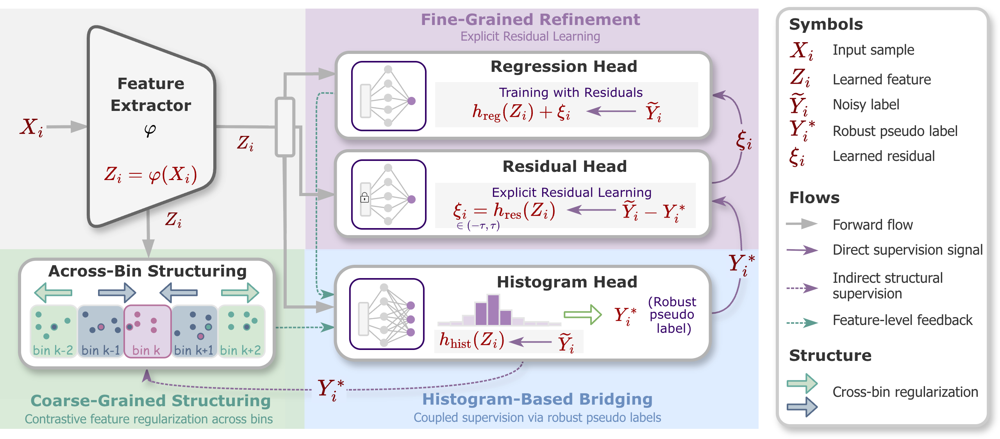

# GRAIN: Dual-Granularity Learning for Regression with Continuous Noisy Labels

**Hui Guo · Boyu Wang · Grace Y. Yi**  
**NeurIPS 2026**

Official implementation of **GRAIN**, a dual-granularity framework for robust deep regression with continuous noisy labels.

## Overview

<p align="center">
  
</p>

Continuous noisy labels pose two challenges: heterogeneous noise magnitudes across instances and distorted feature geometry. GRAIN addresses both through complementary mechanisms:

- **Fine-grained residual refinement:** Models instance-specific deviations using a capacity-constrained residual head derived from a robust loss formulation.
- **Coarse-grained structural learning:** Uses binning-based contrastive regularization with unbalanced optimal transport to encourage order-preserving feature representations.
- **Histogram-based bridging:** Generates robust pseudo labels to couple residual refinement and structural learning.

## Datasets

Experiments cover four datasets across three regression tasks:

- **UTKFace** and **APPA-REAL** — Age estimation
- **Biwi Kinect** — Head-pose estimation
- **RSNA / DHA Bone-Age** — Bone-age assessment

## Citation

If you find this work useful, please cite:

```bibtex
@inproceedings{guo2026grain,
  title={Dual-Granularity Learning for Regression with Continuous Noisy Labels},
  author={Guo, Hui and Wang, Boyu and Yi, Grace Y.},
  booktitle={Advances in Neural Information Processing Systems},
  year={2026}
}
```

> **Note:** Place the framework figure at `assets/framework.png` for it to appear above. Replace this provisional BibTeX entry with the official proceedings citation when available.
